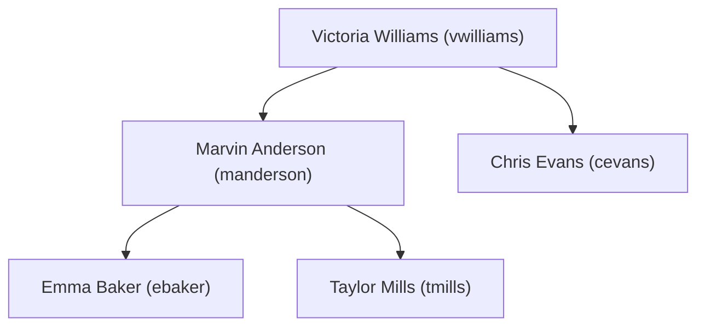

# Deep Data Security example

This example is a Go HTTP service that returns employee records as JSON.
Both endpoints run the same SQL query.
For each request, the service passes the end-user identity to Oracle Database,
which uses data grants to decide which rows and Social Security numbers (SSNs)
appear in the response. The service obtains the required database-access token
for both endpoints using the HR Database confidential app's client credentials.

| Endpoint | What the caller sends | Which user runs the query |
| --- | --- | --- |
| [`POST /employees/username`](#query-as-a-local-end-user) | A JSON body with `username` set to local end-user username. | A local end user defined in Oracle Database. |
| [`POST /employees/token`](#query-as-an-iam-managed-end-user) | The OCI IAM end user's username and password using HTTP Basic authentication. | An IAM-managed end user. The service exchanges the credentials for an end-user access token. |

## Sample employee hierarchy

The base setup creates five rows in `HR_APP.EMPLOYEES`. In the diagram, each
arrow goes from a manager to a direct report. The table stores that
relationship by matching a report's `manager_name` to the manager's
`user_name`.



## What each end user can see

Both the employee and manager grants compare a column with
`ORA_END_USER_CONTEXT.username`, the username Oracle Database sees for the
query. `EMPLOYEE_ROLE` matches `user_name` and grants access to the user's own
record, including their SSN. `MANAGER_ROLE` matches `manager_name` and adds
access to direct reports' records with their SSNs masked. The additional IAM
setup adds an HR employee record and maps the `HR_TEAM` group to `HR_ROLE`,
which can read every record and SSN. See [the sample data grants](SETUP.md#create-the-table-and-data-grants)
and [the data role for IAM-managed end users](SETUP.md#add-the-hr-data-role-and-sample-record).

| End user | Data roles | Rows returned | SSNs visible |
| --- | --- | --- | --- |
| Emma (`ebaker`) | `EMPLOYEE_ROLE` | Emma | Emma's |
| Marvin (`manderson`) | `EMPLOYEE_ROLE`, `MANAGER_ROLE` | Marvin, Emma, Taylor | Marvin's |
| IAM-managed end user | `HR_ROLE` | All six | All six |

## Set up and run

Follow the [database and OCI IAM setup](SETUP.md). Make sure these variables
are available in the environment where you start the service.

| Environment variable | Value |
| --- | --- |
| `DDS_CONNECT_DESCRIPTOR` | The database's TCPS connect descriptor, including the wallet location. |
| `DDS_DB_USER`, `DDS_DB_PASSWORD` | The database pool account and its password. |
| `DDS_IAM_DOMAIN_URL` | The OCI IAM identity domain's HTTPS URL. |
| `DDS_DATABASE_CLIENT_ID`, `DDS_DATABASE_CLIENT_SECRET` | Client ID and client secret of the **HR Database** confidential app, used to obtain the database-access token. |
| `DDS_DATABASE_SCOPE` | The scope for the database-access token. |
| `ORACLE_GO_WALLET_PASSWORD` | Required if the wallet key is encrypted. |
| `DDS_APP_CLIENT_ID`, `DDS_APP_CLIENT_SECRET` | Client ID and client secret of the **HR Application** confidential app, required when `DDS_APP_SCOPE` is set. |
| `DDS_APP_SCOPE` | The application scope for the end-user access token. Set it to enable `POST /employees/token`. |

Run the service. For example, from the repository root:

```sh
go run ./examples/deep_data_security
```

## Query as a local end user

For example, call `POST /employees/username` as Emma (`ebaker`) or Marvin
(`manderson`).

```sh
curl --fail-with-body --json '{"username":"ebaker"}' \
  http://localhost:8080/employees/username

curl --fail-with-body --json '{"username":"manderson"}' \
  http://localhost:8080/employees/username
```

For Marvin, Oracle Database returns the direct reports' SSNs as SQL `NULL`.
The Go service uses `sql.NullString` for SSNs and returns masked values as
JSON `null`.

```json
[
  {"first_name":"Marvin","last_name":"Anderson","ssn":"000-00-0200"},
  {"first_name":"Emma","last_name":"Baker","ssn":null},
  {"first_name":"Taylor","last_name":"Mills","ssn":null}
]
```

## Query as an IAM-managed end user

Set `DDS_APP_CLIENT_ID`, `DDS_APP_CLIENT_SECRET`, and `DDS_APP_SCOPE` and restart the service after completing the additional
configuration. See how to [configure an IAM-managed end user](SETUP.md#configure-an-iam-managed-end-user).

The endpoint sends the credentials to OCI IAM using the OAuth 2.0 Resource
Owner Password Credentials grant and gets an end-user access token for
`DDS_USER_SCOPE`. It also obtains the database-access token for
`DDS_DATABASE_SCOPE` and passes both tokens to Oracle Database.

**The password grant is for local testing only.**

Pass the OCI IAM test username to `curl` and enter the password when prompted.

```sh
curl --fail-with-body --request POST --basic --user 'your-oci-iam-test-username' \
  http://localhost:8080/employees/token
```

The end-user token carries the group claim that enables `HR_ROLE` for the
sample IAM-managed end user.

## How the service uses DDS

Each handler builds an end-user security context with a database-access token
and either the username or the end-user token. The service calls
`SetEndUserSecurityContext` on a dedicated connection and runs the query
below. It calls `ClearEndUserSecurityContext` before releasing the connection.

```sql
SELECT first_name, last_name, ssn
FROM hr_app.employees
ORDER BY employee_id;
```

See the [implementation](main.go) and learn more in the
[Go Deep Data Security guide](../../documentation/deep_data_security.md).

To supply the context for each query through a provider, see the
[provider example](provider/README.md).
