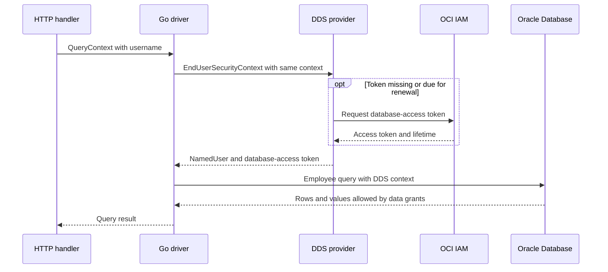

# Deep Data Security provider example

This Go HTTP service uses a `DeepDataSecurityProvider` to run the same
employee query for different local end users.

## Set up and run

Follow the [database and OCI IAM setup](../SETUP.md) through **Create the
table and data grants**. Make sure these variables are available in the
environment where you start the service.

| Environment variable | Value |
| --- | --- |
| `DDS_CONNECT_DESCRIPTOR` | The database's TCPS connect descriptor, including the wallet location. |
| `DDS_DB_USER`, `DDS_DB_PASSWORD` | The database account and its password. |
| `DDS_IAM_DOMAIN_URL` | The OCI IAM identity domain's HTTPS URL. |
| `DDS_IAM_CLIENT_ID`, `DDS_IAM_CLIENT_SECRET` | The OCI IAM confidential application's client credentials. |
| `DDS_DATABASE_SCOPE` | The scope for the database-access token. |
| `ORACLE_GO_WALLET_PASSWORD` | Required if the wallet key is encrypted. |

Run the service. For example, from the repository root:

```sh
go run ./examples/deep_data_security/provider
```

## Query as a local end user

Send the local end user's name in the `username` field of a JSON request to
`POST /employees/username`.

```sh
curl --fail-with-body --json '{"username":"manderson"}' \
  http://localhost:8081/employees/username
```

## How the provider gets the username

The handler adds the username to the request's Go context and passes it to
`db.QueryContext`. The driver calls `EndUserSecurityContext` with that same
context. The provider reads the username and returns `NamedUser` with a
current `DatabaseAccessToken`.



The provider fetches the application's token on the first query and caches
it. When a later query arrives near or after expiry, the provider obtains a
fresh token from OCI IAM before the SQL runs. The HTTP caller supplies only
the username. 